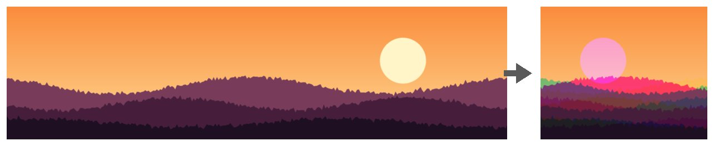
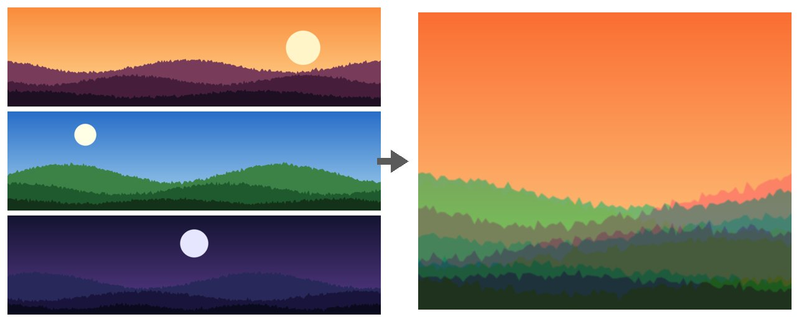

# ChannelSwap

Create color-swapped images by recombining RGB channels across images.

Documentation: [lucidbeaming.com/art/code/channelswap](https://lucidbeaming.com/art/code/channelswap)



A Python script that creates artistic color-swapped images by combining RGB channels from different sections of images. The script can process images individually or in groups, extracting left, middle, and right sections and reassigning their color channels to create unique visual effects.

## Features

- **Single Image Mode**: Split a single image into three sections and swap their RGB channels
- **Group Mode**: Combine RGB channels from three different images
- **Random Mode**: Create random combinations from a directory of images
- **Cycle Mode**: Generate three variations with rotated channel assignments
- **Brightness Variation**: Apply random brightness adjustments to sections
- **Configurable Dimensions**: Customize section height and width ratio

## Requirements

- Python 3.7+
- numpy >= 1.20.0
- Pillow >= 9.1.0

## Installation

```bash
git clone https://github.com/lucidbeaming/channelswap.git
cd channelswap
pip install -r requirements.txt
```

## Usage

### Basic Usage

Process images in groups of three (default mode):

```bash
python swap.py input_directory output_directory
```

### Processing Modes

**Single Image Mode**: Process each image individually, splitting it into sections:

```bash
python swap.py input/ output/ --mode single
```

**Group Mode**: Process images in consecutive groups of three (default):

```bash
python swap.py input/ output/ --mode group
```



**Random Mode**: Create random combinations from all images in the directory:

```bash
python swap.py input/ output/ --mode random
```

### Options

- `--bright`: Apply random brightness variation to sections (±15% by default)
- `--cycle`: Create three versions of each output with rotated channel assignments
- `--height HEIGHT`: Set target height for image sections in pixels (default: 4096)
- `--width-ratio RATIO`: Set ratio of section width to height (default: 1.25)
- `--brightness-variation FACTOR`: Maximum brightness variation factor when using `--bright` (default: 0.15)
- `--log-file PATH`: Specify path to log file (default: channel_swap.log)
- `--debug`: Enable debug logging

### Input and output

- Input: every `.png`, `.jpg` and `.jpeg` file in the input directory. Wide images work best: each section is `--height` × `--width-ratio` wide after scaling, and on narrower images the sections shrink to a third of the width.
- Output: PNG files named `single_<hash>.png` or `group_<hash>.png`. With `--cycle`, each output becomes three files with `_cycle0`, `_cycle1` and `_cycle2` suffixes.
- The output directory is created if it doesn't exist.

### Examples

Create three rotated versions with brightness variation:

```bash
python swap.py input/ output/ --cycle --bright
```

Use custom dimensions for smaller images:

```bash
python swap.py input/ output/ --height 2048 --width-ratio 1.5
```

Process single images with debug logging:

```bash
python swap.py input/ output/ --mode single --debug
```

## How It Works

1. **Section Extraction**: Each image is resized to a target height and split into three sections:
   - Left section (from the left edge)
   - Middle section (from the center)
   - Right section (from the right edge)

2. **Channel Assignment**: RGB channels are reassigned:
   - Red channel from the left section
   - Green channel from the middle section
   - Blue channel from the right section

3. **Output**: The combined channels create a new image with swapped colors.

In cycle mode, three variations are created with different channel rotations, and in group mode, channels come from three different images.

## Related projects

- [p5-audio-visualizers](https://github.com/lucidbeaming/p5-audio-visualizers): generative visuals driven by sound
- [mutant](https://github.com/lucidbeaming/mutant): desktop batch media converter built on ffmpeg and ImageMagick

## License

[MIT](LICENSE). Releases before this change were published under GPL-3.0, and those copies keep that license.
